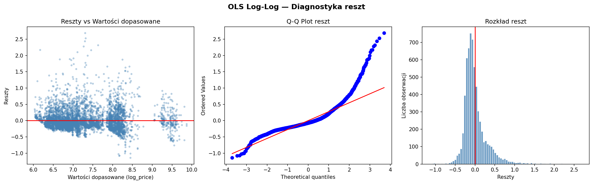

# 🦋 CS2 Butterfly Knife – Hedonic Pricing & Machine Learning

[](https://www.python.org/)
[](https://streamlit.io/)
[](https://opensource.org/licenses/MIT)

An empirical study on virtual asset valuation within the *Counter-Strike 2* digital economy, focusing on **Butterfly Knife** skins. This project serves as the practical implementation of a Bachelor's thesis, bridging microeconomic theory (Rosen's hedonic pricing model) with machine learning techniques and exploratory market data analysis.

---

## 📌 Key Objectives
1. **Econometric Price Decomposition (Hedonic Model):** Estimate the marginal valuations (*shadow prices*) of knife attributes, including wear degradation (*float value*), skin finishes, StatTrak™ technology, and rare collector patterns (*Case Hardened Blue Gems*, *Doppler* phases).
2. **Model Specification Diagnostics:** Test and evaluate OLS assumptions, including heteroskedasticity, non-normality of residuals, and non-linearities in finish wear degradation.
3. **Machine Learning Benchmarking (Work in Progress):** Train non-linear ensemble models (Random Forest, LightGBM) to capture complex feature interactions, and interpret predictions using Shapley Additive exPlanations (**SHAP**).
4. **Interactive Market Analytics:** Develop a web-based dashboard in **Streamlit** for dynamic multi-dimensional filtering and exploratory data analysis.

---

## 📊 Data Pipeline & Preprocessing
Market transaction and listing data were collected directly from the **CSFloat** marketplace via API.
* **Domain-Specific Feature Engineering:**
  * Extracted skin finish names and exterior wear categories (*Factory New*, *Field-Tested*, etc.).
  * Classified distinct Doppler phases based on `paint_index` (Phase 1–4, Ruby, Sapphire, Black Pearl, Emerald).
  * Flagged rare collector patterns (*Case Hardened Blue Gem*) using verified tier lists based on `paint_seed`.
* **Data Cleaning & Anomaly Detection:**
  * Removed non-physical wear artifacts (`float_value == 0` for Vanilla knives).
  * Filtered out artificial, non-market listing outliers (> 99th percentile) not backed by verified collector rarity tiers.

---

## 📈 OLS Hedonic Pricing Model (Log-Log Specification)

The baseline econometric model is specified in a double/semi-logarithmic form:
$$\ln(\text{Price}_i) = \beta_0 + \beta_1 \ln(\text{Float}_i) + \beta_2 \text{StatTrak}_i + \beta_3 \text{Gem}_i + \beta_4 \text{BlueGem}_i + \sum \gamma_j \text{Skin}_j + \varepsilon_i$$

### Residual Diagnostics:
The model was estimated using `statsmodels`. Diagnostic plots reveal residual non-normality and a heavy right tail (underestimation of ultra-rare tier items):

<p align="center">
  
</p>

*Key Diagnostic Insights:* Residuals diverge significantly from the theoretical normal distribution at the upper quantiles (Q-Q plot), providing strong empirical justification for exploring non-linear, tree-based machine learning approaches.

---

## 🖥️ Interactive Dashboard (Streamlit)

The application provides an interactive interface to explore price distributions, StatTrak premiums, and wear-to-price relationships:

```bash
# Run the dashboard locally
streamlit run src/dashboard.py
```

---

## 🚀 Getting Started

1. **Clone the repository:**
   ```bash
   git clone [https://github.com/](https://github.com/)<your-username>/cs2-butterfly-hedonic-pricing.git
   cd cs2-butterfly-hedonic-pricing
   ```

2. **Create and activate a virtual environment:**
   ```bash
   python -m venv venv
   # On Linux / macOS:
   source venv/bin/activate
   # On Windows:
   venv\Scripts\activate
   ```

3. **Install dependencies:**
   ```bash
   pip install -r requirements.txt
   ```

4. **Run the scripts:**
   * OLS Hedonic Model: `python src/ols_hedonic_model.py`
   * Streamlit Dashboard: `streamlit run src/dashboard.py`

---

## 🛠️ Tech Stack
* **Language:** Python 3.10+
* **Econometrics & Statistics:** `statsmodels`, `scipy`
* **Data Manipulation & Analysis:** `pandas`, `numpy`
* **Visualization & Web App:** `streamlit`, `plotly`, `matplotlib`
* **Machine Learning & XAI (Next Step):** `scikit-learn`, `lightgbm`, `shap`